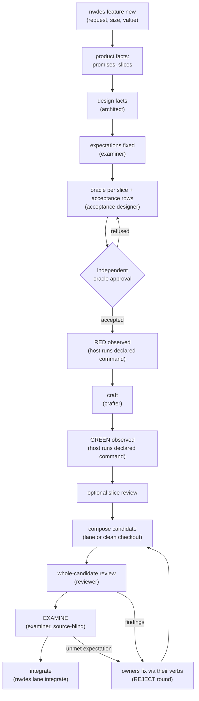

# Understanding delivery artifacts

A delivery produces a small set of artifacts, each owned by one role. This
page explains what each artifact is, who produces it, in what order, and what
you see as the user. For the step-by-step procedure, read
[Deliver a feature](../nwdes/deliver-feature.md); for verb details, the
[nwdes reference](../nwdes/reference/index.md).

## The handoff is the record

Every feature has exactly one **handoff**: `docs/feature/ID/handoff.json` in
your repository. It holds what the roles recorded — the original request, the
size and value, product promises and slices, design facts, examiner
expectations, acceptance rows, the optional charter, and examination
verdicts. `nwdes document` renders human-readable briefs (`brief.md`,
`architecture.md`, `acceptance.md`, with HTML versions) beside it; `nwdes
delta` compares two handoff revisions.

The handoff is also the resume point. nwdes keeps no workflow state, so after
an interruption the root assistant reads the handoff and the current briefs,
reuses only still-applicable observations, and continues. Run records
(`runs/craft.S1.json`, `runs/review.candidate.json`, ...) sit next to the
handoff and capture what each role closed.

## Who produces what, in what order

| # | Artifact | Produced by | What it is |
|---|---|---|---|
| 1 | Handoff | nwdes, from `nwdes feature new` and later verbs | The canonical record of the feature |
| 2 | Product promises and slices | The root assistant, or the product owner on a genuine question | A **promise** is a public outcome ("the search result is returned"); a **slice** is one observable behavior with the promises it serves |
| 3 | Design facts | The architect (`nwdes design` verbs) | Paradigm, boundaries, reuse, constraints, decisions; optional ADRs in your repository |
| 4 | Expectations | The examiner (`nwdes expectations` verbs) | The fixed E-numbered rows every public promise must be judged against, fixed once per feature before oracle authoring |
| 5 | Public oracle and acceptance rows | The acceptance designer (`nwdes acceptance` verbs) | An **oracle** is an executable check of the promised behavior through the public surface; each row records stimulus, expected result and `still_passes_if` — the nearest wrong behavior the test would still accept |
| 6 | Independent oracle approval | Reviewer | Each oracle is independently approved before craft begins |
| 7 | RED, then implementation, then GREEN | Crafter (`nwdes craft` verbs); the host observes | **RED** is the observed failure of the missing behavior; **GREEN** is the observed pass of the implemented one |
| 8 | Slice review (optional) and whole-candidate review (required) | Reviewer (`nwdes review` verbs) | One fresh independent review of the assembled candidate; it never reuses an embedded slice review as approval |
| 9 | Charter (optional) | Product owner (`nwdes charter` verbs) | One per feature: intent, exploration, at least one positive and one negative observation |
| 10 | EXAMINE verdicts | Examiner (`nwdes examine` verbs) | Source-blind judgment of every expectation from the user's point of view, on the whole feature |

## The flow

Lanes are optional: a **lane** is an isolated Git worktree per feature
(`nwdes lane open`) used to run features in parallel and integrate without
rewriting trunk. Without a lane, the same order runs in your current clean
checkout and you skip compose and integrate ([Use lanes](../nwdes/use-lanes.md)).

## What you see

- Prompts and packets are printed by `nwdes prompt` and `nwdes packet`; the
  root assistant passes them to roles verbatim.
- Briefs rendered by `nwdes document` are the shared reading surface for
  discussing intent and open questions.
- Refusals return to the owning role with their WHAT/WHY/HOW text unchanged;
  the role corrects its own values with its verbs. On a rejected close, each
  finding owner reads exactly its own findings.

Read [Understanding nwdes](../understanding-nwdes/) for why the tool is
shaped this way, and [What's new in v4](../whats-new-v4/) for the change
from 3.x.
